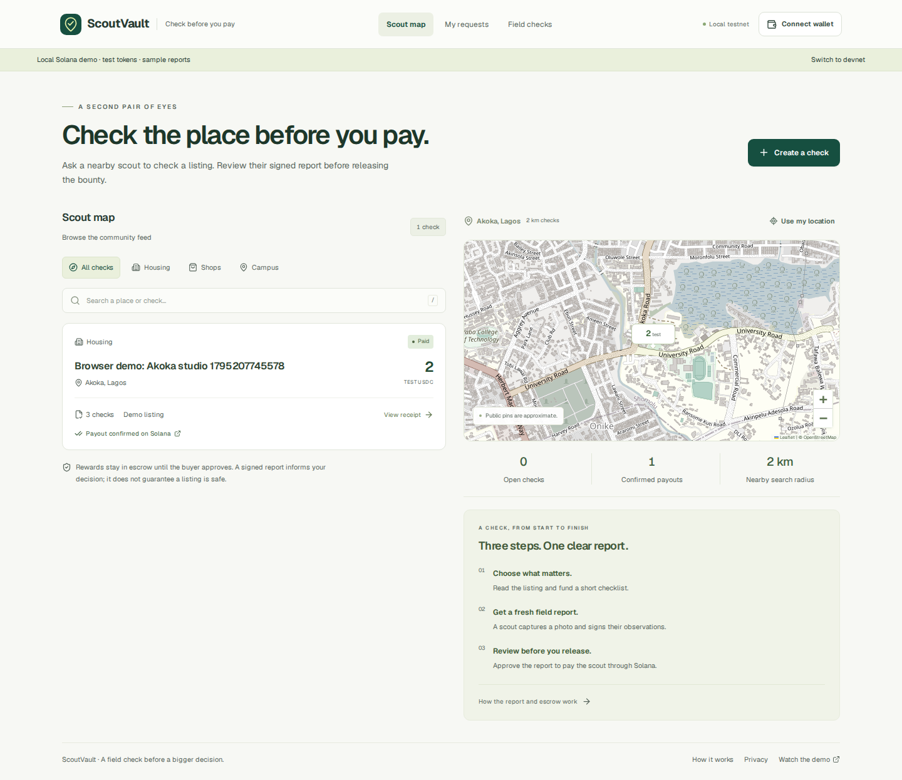

# ScoutVault

Ask someone nearby to check a listing before you send a deposit.

[Open ScoutVault](https://scoutvault-checks.vercel.app) · [Watch the 2:30 walkthrough](https://scoutvault-checks.vercel.app/demo/) · [Download Android](https://github.com/NSEVEjk0/scoutvault/releases/tag/v0.1.0) · [Solana devnet program](https://explorer.solana.com/address/Bs6t2UmHXvxE3WF1upyXTpSkehhUxin7wzZt1c2G8MNV?cluster=devnet)



## What a listing leaves out

A student looking for a room near campus sees a price, an address, and a promise of running water. A phone call can repeat those claims. A person nearby can check the entrance, ask what the rent covers, and look for the advertised water tank.

ScoutVault gives that person a short checklist and sets aside a reward before they go. The requester reads the signed report before approving payment.

## From listing to payout

1. Paste a public link. Firecrawl reads it. ScoutVault turns details such as the address, price, and amenities into an editable checklist.
2. Mark the entrance on the map and choose a reward. The Anchor program on Solana holds the tokens for that check.
3. A scout claims the check, answers the questions, and adds a photo. The scout signs a report tied to the bounty. On Android, a compatible wallet signs through Mobile Wallet Adapter.
4. The requester reviews the photo and answers. Their approval names the exact report hash. The program releases the reward and the app links to the transaction receipt.

The checklist is available as text. **Play brief** reads it aloud with a browser or device voice. The public map uses approximate pins. The participants can open the private report and photo.

## Try the sample listing

Open **Connect wallet → Try with test funds** for a demo buyer and scout. Choose **Create a check → Read listing** to see the three checks for the sample studio. Fund the check, switch to the scout to send the sample report, then switch back to review and pay. The walkthrough follows this flow on Solana devnet. [Sample listing](https://scoutvault-checks.vercel.app/listings/akoka-studio.html) · [Finalized payout](https://explorer.solana.com/tx/3zSVqcCExnJiLqKwrtcEPzsxdhnuWQi3LKJLvwjnDB3PHXycJvsbXvBdo2qfsFBpwX2txAyxFN1RqRBA7iyw7ZXm?cluster=devnet).

[Verification record](docs/validation.md) · [Hosting and devnet setup](docs/infrastructure.md) · [Report and location data](docs/privacy.md)

## What the report can establish

The wallet signature ties the submitted answers and photo hash to the signing wallet and bounty. The requester still decides whether the answers and photo are enough to pay. The recording uses a labelled sample image and software test wallets. [How request and dispute approval work](docs/architecture.md).

## Work before the event

The web app, Android client, Anchor escrow, listing reader, and hosted devnet demo were built before the November 27 Dev3Pack kickoff. [Commit history](https://github.com/NSEVEjk0/scoutvault/commits/main/) · [Dev3Pack FAQ](https://hack.dev3pack.xyz/faq).

## Run it locally

Use Node 24, Docker Compose, and Solana build tools. The Android build also needs JDK 21 and the Android SDK.

```sh
npm ci
npm --prefix server ci
node scripts/create-keys.mjs
node scripts/setup-infra.mjs
docker compose --env-file .local/deployment.env -f infra/compose.yml up -d
docker compose --env-file .local/deployment.env -f infra/firecrawl.yml up -d
```

Compile the Anchor program with `cargo-build-sbf --manifest-path contracts/programs/scout_vault/Cargo.toml --sbf-out-dir .local/deploy`. Then start `node scripts/start-validator.mjs` in its own terminal.

```sh
node scripts/setup-local-test.mjs
node --env-file=.local/local-test.env scripts/init-chain.mjs
cd server
node --env-file=../.local/local-test.env index.mjs
```

From the repository root, start `SCOUTVAULT_API_PROXY=http://127.0.0.1:45580 npm run dev`. For checks and Android packaging, see [Validation](docs/validation.md) and [Hosting](docs/infrastructure.md). Keep the generated `.local/` files private.

[MIT license](LICENSE) · [Dev3Pack checklist](docs/submission.md)
