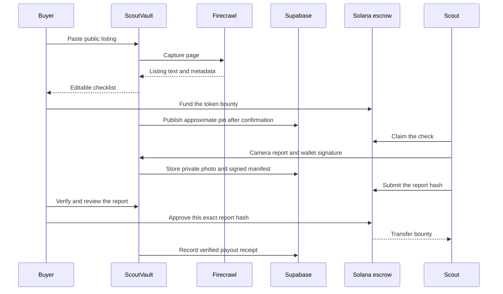

# How a check moves through ScoutVault

The listing is captured first. Firecrawl fetches a public URL, and ScoutVault extracts the visible address, price, and a concrete feature where available. A server receipt records the captured source. Requesters can edit the questions, but cannot turn altered source claims into a valid Firecrawl receipt.

Funding creates a Solana program-derived escrow and token vault. The configured six-decimal SPL token is the only token accepted. The buyer record retains the last bounty ID so closing an escrow does not permit ID reuse.

The server accepts a state change only after it reads a confirmed transaction containing the expected event from the configured program. It checks the signer, bounty ID, escrow, mint, and relevant report hash. The UI does not turn an optimistic click into a paid bounty.

A report manifest contains the bounty ID, wallet, one-time capture challenge, timestamp, photo hash, answers, note, and location metadata. The original JPEG is private so its bytes remain independently checkable against the signed hash. The browser verifies the photo hash, manifest hash, and Ed25519 signature before enabling payment.

The Android app opens the same interface inside an origin-restricted WebView. Native requests are limited to wallet connection/signing, camera capture, foreground location, and device speech. Listing and Explorer links open outside the trusted app origin.

Disputes require buyer authorization. The arbiter frozen in the escrow can resolve only a disputed bounty. There is no automatic release based on a claimed GPS position or photo upload.
